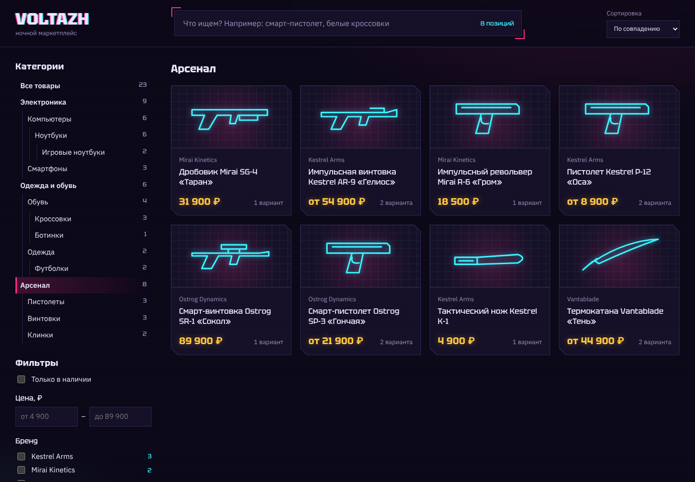

# Тема 1. Движок каталога и «умного» поиска

Python + FastAPI (Swagger) + SQLAlchemy + **SQLite**.



SQLite встроена в Python, поэтому ставить отдельную СУБД не нужно. База хранится в одном файле `catalog.db`,
он создаётся автоматически.

Что реализовано:
- многоуровневое дерево категорий: рекурсивные CTE и материализованный путь;
- разделение товаров на SPU и SKU;
- характеристики в гибридном виде: EAV + JSON;
- фасетная фильтрация с динамическим подсчётом;
- полнотекстовый поиск с ранжированием по релевантности (FTS5 + bm25).

## Как запустить (Windows)

Нужен только **Python 3.11+** (python.org, при установке отметьте «Add python.exe to PATH»).

```bat
cd catalog_search
python -m venv .venv
.venv\Scripts\activate
pip install -r requirements.txt
python -m uvicorn app.main:app --reload
```

Откройте в браузере:
- **http://127.0.0.1:8000/**: витрина магазина VOLTAZH в неоновом киберпанк-стиле
  (категории, поиск, фильтры со счётчиками, карточка товара);
- **http://127.0.0.1:8000/simple**: простая версия того же сайта (обычный светлый вид, короткий код
  в `app/static/simple/`), удобна для показа и объяснения;
- **http://127.0.0.1:8000/docs**: Swagger, где все методы API можно вызвать вручную.

При первом запуске база создаётся и заполняется демо-данными сама.
Если база осталась от старой версии и в ней нет раздела «Арсенал», выполните `python -m app.seed`.

Ещё две команды:

```bat
python demo.py            :: все алгоритмы с выводом в консоль
python -m pytest -v       :: 25 автотестов
```

## Структура

| Файл | Что внутри |
|---|---|
| `app/models.py` | Таблицы БД |
| `app/catalog.py` | Все алгоритмы: дерево, фасеты, поиск, добавление товара |
| `app/search_index.py` | Полнотекстовый индекс FTS5 и триггеры, которые его обновляют |
| `app/main.py` | REST API + отдача витрины |
| `app/static/` | Неоновая витрина: `index.html`, `style.css`, `app.js` и шрифты (Tektur, IBM Plex Sans, лицензия OFL) |
| `app/static/simple/` | Простая версия витрины с тем же функционалом |
| `app/seed.py` | Демо-каталог: 15 категорий, 23 товара, 47 SKU (включая вымышленный «Арсенал») |
| `demo.py` | Демонстрация в консоли |
| `tests/` | Автотесты |
| `schema.sql` | SQL-схема для отчёта |

## Модель БД

| Таблица | Назначение |
|---|---|
| `categories` | Дерево категорий: `parent_id` (ссылка на себя), `path` (`1/2/3/`), `level` |
| `brands` | Бренды |
| `products` | **SPU**: общая карточка («Кроссовки Nike Air Max 90») + `extra` (JSON) |
| `skus` | **SKU**: конкретный вариант (размер 42, белый) со своей ценой и остатком |
| `attributes` | **EAV, Attribute**: справочник характеристик (ОЗУ, Цвет, Размер) |
| `category_attributes` | Какие характеристики есть у категории (M:N), наследуются вниз по дереву |
| `sku_attribute_values` | **EAV, Value**: значение характеристики у SKU (`value_text` + `value_num`) |
| `product_fts` | Полнотекстовый индекс FTS5 |

### Гибридный подход к характеристикам (EAV + JSON)
- **EAV**: всё, по чему **фильтруют** (ОЗУ, размер, цвет). У каждой категории свой набор характеристик,
  при этом новые таблицы не нужны: новая характеристика добавляется строкой в `attributes`.
  Числа хранятся ещё и в `value_num`, чтобы сортировать как числа: 8 < 16 < 32, а не «16» < «32» < «8».
- **JSON** (`products.extra`): описательные свойства, по которым **не фильтруют** (гарантия, вес, комплектация).
  Хранить их в EAV было бы лишней сложностью. В SQLite из JSON можно читать прямо в запросе:
  `SELECT name FROM products WHERE json_extract(extra, '$."Гарантия"') = '2 года'`.

## Алгоритмы

### 1. Обход дерева категорий: рекурсивный CTE

```sql
WITH RECURSIVE subtree(id, depth) AS (
    SELECT id, 0 FROM categories WHERE id = :category_id   -- стартовая категория
    UNION ALL
    SELECT c.id, s.depth + 1                               -- её дети, внуки, ...
    FROM categories c
    JOIN subtree s ON c.parent_id = s.id
)
SELECT * FROM products WHERE category_id IN (SELECT id FROM subtree);
```
Как это работает: сначала в `subtree` попадает сама категория. Затем на каждом шаге
добавляются категории, у которых `parent_id` равен уже найденным. Цикл идёт, пока появляются новые строки.
Поэтому запрос работает при любой глубине вложенности.

Там же реализованы:
- **хлебные крошки**: рекурсия в обратную сторону, от категории вверх к корню (`JOIN chain ON c.id = ch.parent_id`);
- **дерево с количеством товаров**: рекурсивный CTE строит пары «предок → потомок» сразу для всех категорий.

### 1. Альтернатива: материализованный путь (Materialized Path)
У каждой категории хранится путь от корня: «Ноутбуки» = `1/2/3/`. Все подкатегории находятся без рекурсии:
```sql
WHERE c.path LIKE '1/2/%'
```

| | Adjacency List (`parent_id`) + CTE | Materialized Path (`path`) |
|---|---|---|
| Чтение поддерева | Рекурсивный запрос | Один `LIKE`, быстрее |
| Перенос категории | Меняется одно поле | Нужно переписать `path` у всех потомков |

В проекте есть оба способа: параметр `method=cte` или `method=path`. Тест проверяет, что результаты совпадают.

### 2. Фасетная фильтрация
Фасеты это фильтры со счётчиками, как в левой колонке на маркетплейсах: «ОЗУ: 8 ГБ (3), 16 ГБ (6), 32 ГБ (2)».
Счётчики пересчитываются **динамически** под текущий поиск и выбранные фильтры.

Правила:
1. Значения одной характеристики объединяются через **ИЛИ** (16 ГБ или 32 ГБ),
   разные характеристики через **И** (ОЗУ и процессор).
2. Фильтры проверяются **на уровне SKU**. «Размер 43 + чёрный» найдёт товар, только если есть
   SKU, у которого одновременно 43-й размер и чёрный цвет.
3. **При подсчёте фасета характеристики X фильтр по самой X не применяется**, а все остальные применяются.
   Иначе после выбора «16 ГБ» пропали бы варианты «8 ГБ» и «32 ГБ», и выбрать несколько значений было бы нельзя.
4. Считаются **товары (SPU)**, а не SKU: `COUNT(DISTINCT p.id)`.

```sql
SELECT v.value_text, COUNT(DISTINCT p.id)
FROM skus s
JOIN products p ON p.id = s.product_id
JOIN sku_attribute_values v ON v.sku_id = s.id
JOIN attributes a ON a.id = v.attribute_id
WHERE a.code = 'ram'
  AND <все фильтры, КРОМЕ фильтра по ram>
GROUP BY v.value_text;
```

### 3. Полнотекстовый поиск с ранжированием
Используется **FTS5**, встроенный в SQLite модуль полнотекстового поиска. Он строит **обратный индекс**
«слово → товары, где оно встречается», поэтому не перебирает все строки, как `LIKE '%...%'`.

- **Что индексируется**: название, описание, бренд, категория и значения характеристик.
  Поэтому «белые кроссовки» находятся, хотя цвет хранится в характеристиках SKU.
- **Индекс обновляется триггерами**: при добавлении или изменении товара SQLite сам обновляет `product_fts`.
- **Ранжирование bm25**: стандартная формула поисковиков. Она учитывает, сколько раз встретилось слово
  и насколько оно редкое. Поля имеют разный вес: название 10, бренд 5, категория 3,
  характеристики 2, описание 1. Совпадение в названии поднимает товар выше.
- **Русский язык**: FTS5 не знает русских окончаний. Поэтому используется упрощённый стемминг:
  от слова отрезается окончание, и поиск идёт по началу слова.
  «кроссовок» → `кроссов*` находит «кроссовки», «кроссовок», «кроссовками».
  Служебные слова («для», «и», «в») отбрасываются, «ё» приравнивается к «е».
- **Запасной вариант**: если в сборке SQLite нет FTS5, поиск автоматически переключается на `LIKE`
  с ручным подсчётом релевантности.

```sql
SELECT rowid, bm25(product_fts, 10.0, 1.0, 5.0, 3.0, 2.0) AS score
FROM product_fts
WHERE product_fts MATCH '"бел"* "кроссов"*'
ORDER BY score;            -- чем меньше score, тем релевантнее
```

## Примеры в Swagger

| Что | Запрос |
|---|---|
| Дерево категорий | `GET /categories/tree` |
| Все товары «Электроники» с подкатегориями | `GET /categories/1/products` |
| Хлебные крошки | `GET /categories/4/breadcrumbs` |
| Поиск | `GET /search?q=белые кроссовки` |
| Ноутбуки с 16 или 32 ГБ, по возрастанию цены | `GET /search?category_id=3&f=ram:16&f=ram:32&sort=price_asc` |
| Поиск + фильтры + бренд | `GET /search?q=кроссовки&f=shoe_size:42&brand=Nike` |
| Карточка товара | `GET /products/1` |
| Добавить товар | `POST /products` (пример уже заполнен в Swagger) |

Фильтры передаются как `f=код:значение`. Коды характеристик: `ram`, `cpu`, `screen`, `storage`,
`color`, `shoe_size`, `cloth_size`, `material`.

## Почему SQLite

SQLite не требует установки и подходит для каталога, где данные в основном **читают**
(поиск, фильтры), а меняют редко. Всё нужное для темы в ней есть: рекурсивные CTE, JSON,
полнотекстовый поиск FTS5 с bm25, триггеры, внешние ключи. В PostgreSQL то же самое делается
через `WITH RECURSIVE`, `JSONB` и `tsvector`/`ts_rank`.
