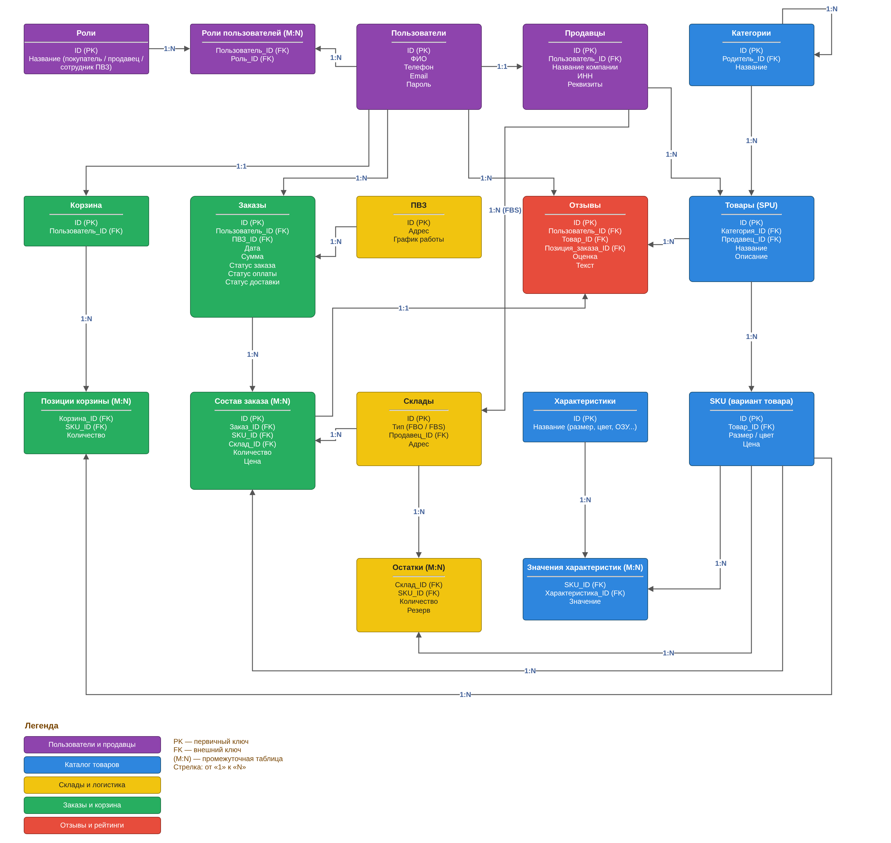

# ER-диаграмма маркетплейса (MVP)

Логическая модель ядра маркетплейса: 17 таблиц в 5 доменах.

- `marketplace_er.drawio` — схема; открыть на [app.diagrams.net](https://app.diagrams.net) через «Файл → Открыть с устройства».
- `marketplace_er.png` — картинка для просмотра.

| Домен | Цвет | Таблицы |
|---|---|---|
| Пользователи и продавцы | фиолетовый | Роли, Роли пользователей (M:N), Пользователи, Продавцы |
| Каталог | синий | Категории (дерево), Товары (SPU), SKU, Характеристики, Значения характеристик (EAV) |
| Склады и логистика | жёлтый | Склады (FBO/FBS), Остатки, ПВЗ |
| Заказы | зелёный | Корзина, Позиции корзины, Заказы, Состав заказа |
| Отзывы | красный | Отзывы |
